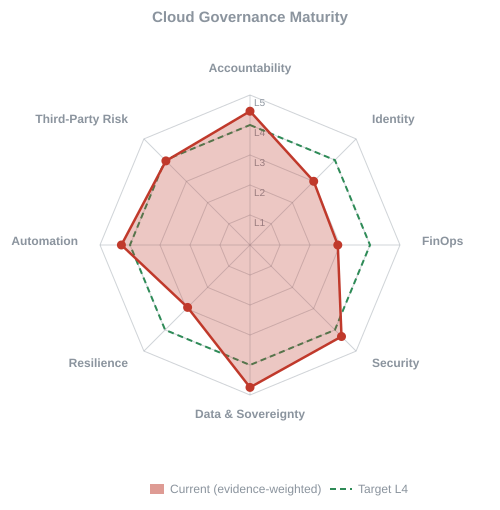
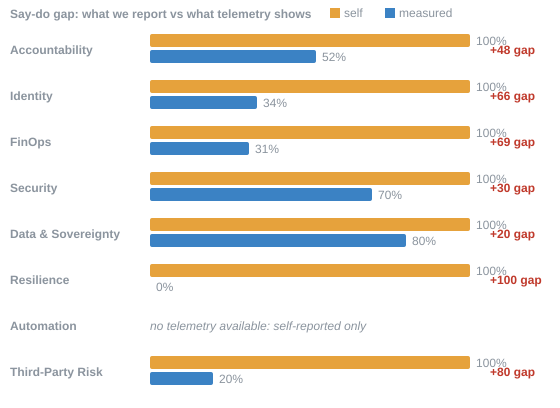
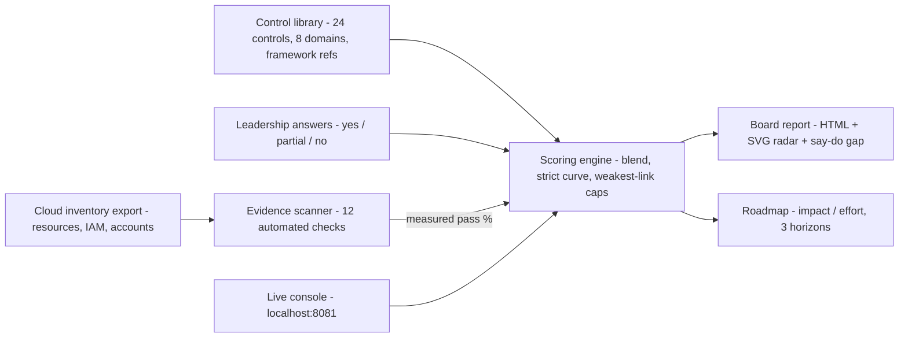
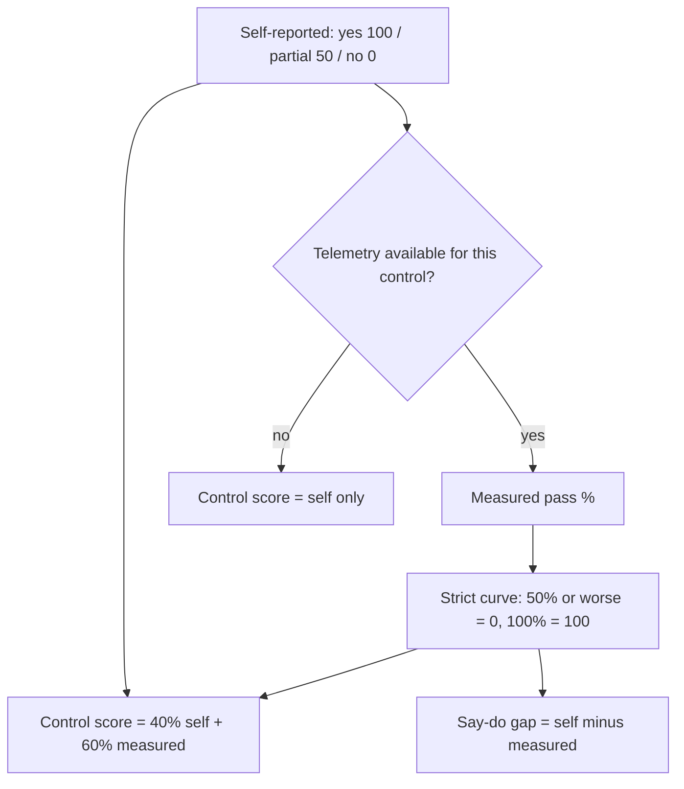
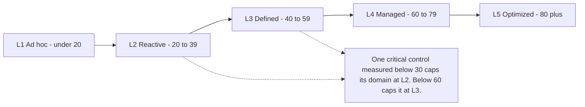
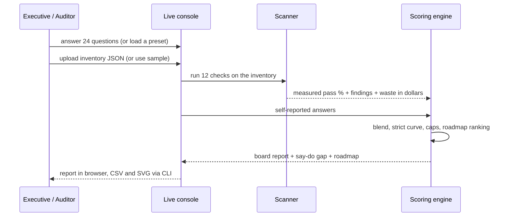

# ☁ Cloud Governance Maturity Toolkit

**The problem:** boards and regulators ask "how mature is our cloud governance?" and most organizations answer with a self-assessed questionnaire. People mark themselves green, and the cloud estate tells a different story. This toolkit does something harder: it scores **what leaders say** and **what telemetry measures** side by side, shows the **say-do gap**, applies a **weakest-link rule**, puts a **dollar value** on waste, and outputs a **prioritized roadmap** and a board-ready report.

```powershell
python -m toolkit assess --answers examples/answers_overconfident.json --inventory examples/sample_inventory.json --out out   # board report, SVGs, CSV roadmap
python -m toolkit serve                                                                                                     # live console: http://localhost:8081
python -m unittest -v tests/test_toolkit.py                                                                                 # 7 tests
```
No dependencies: Python 3.9+ standard library only. Open `out/report.html` in a browser, or see [docs/sample_output/report.html](docs/sample_output/report.html).

## What it produces (generated by the code, from the sample estate)



In the sample, leadership reports 100% on every measurable control. Telemetry says Identity is at 34%, Resilience at 0% (21 critical workloads have no backup) and Third-Party Risk at 20% (64% of the estate sits in one region). The weakest-link rule caps the overall rating at **L3 Defined**, where the questionnaire alone would have said L5.

## Architecture


## How one control is scored


## Maturity ladder and weakest-link rule


## Assessment run


## Domains and automated evidence
| Domain | Example automated checks |
|---|---|
| Accountability | accounts inside the org with a named owner (shadow accounts) |
| Identity | MFA incl. root, wildcard admin policies, dormant identities |
| FinOps | owner + cost-center tags, budget alerts, idle compute and dollar waste |
| Security | public buckets, encryption at rest |
| Data & Sovereignty | resources outside approved regions |
| Resilience | critical workloads without backup |
| Third-Party Risk | region concentration against board appetite |
| Automation, plus the non-telemetry controls | answered by the auditor; included in scoring |

Each control maps to NIST CSF 2.0, NIST 800-53, CIS, ISO 27001, FedRAMP, FFIEC, DORA, GDPR or PCI references. See `toolkit/data/questions.json`.

## Use it on your estate
1. Export your inventory to the shape of `examples/sample_inventory.json` (AWS Config, Azure Resource Graph, GCP Asset Inventory).
2. Have the *auditor*, not the control owner, answer the questions.
3. Run `assess`, take `report.html` to the board, track `roadmap.csv`.
4. Re-run quarterly and trend the say-do gap.

Method details and limits: [docs/METHODOLOGY.md](docs/METHODOLOGY.md).
